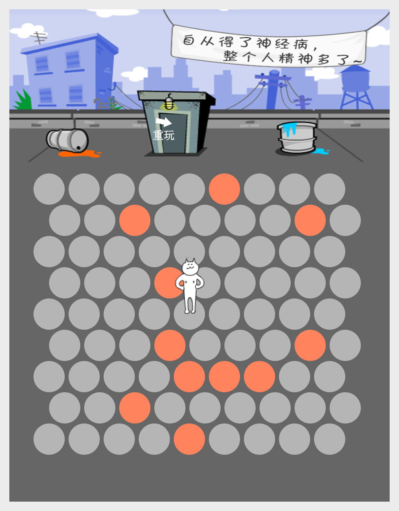

# 围住神经猫（MyGo 版）

用 Go 和 [MyGo](https://mygo.egoist.dev/) 原生 UI 复刻的「围住神经猫」小游戏。纯 Go 绘制，不依赖 WebView 或前端构建。



## 玩法

点击棋盘上的空格放置路障，把小猫困住。小猫被围住时（四周无路可走）你获胜；它每回合都会沿最短路径向棋盘边缘逃跑，一旦跑到边缘你就输了。

## 功能

- 9x9 六边形棋盘，随机生成 6~12 个初始路障
- 小猫使用 BFS 计算到边缘的最短路，等距时优先选择机动性更好的格子
- 逐帧精灵动画：待机 16 帧、被包围 15 帧，38ms 换帧
- 结算弹窗：胜利 / 失败图片、按步数变化的称号、退出与重玩

## 运行

需要 Go 1.27+，Linux 下需要 GTK 3。

```bash
go run .
```

或构建后运行：

```bash
mkdir -p build
go build -o build/psychocat .
./build/psychocat
```

## 目录结构

```
main.go          游戏逻辑与 MyGo 界面
assets/          背景、精灵图与结算图片（通过 go:embed 打包）
screenshot.png   游戏截图
```